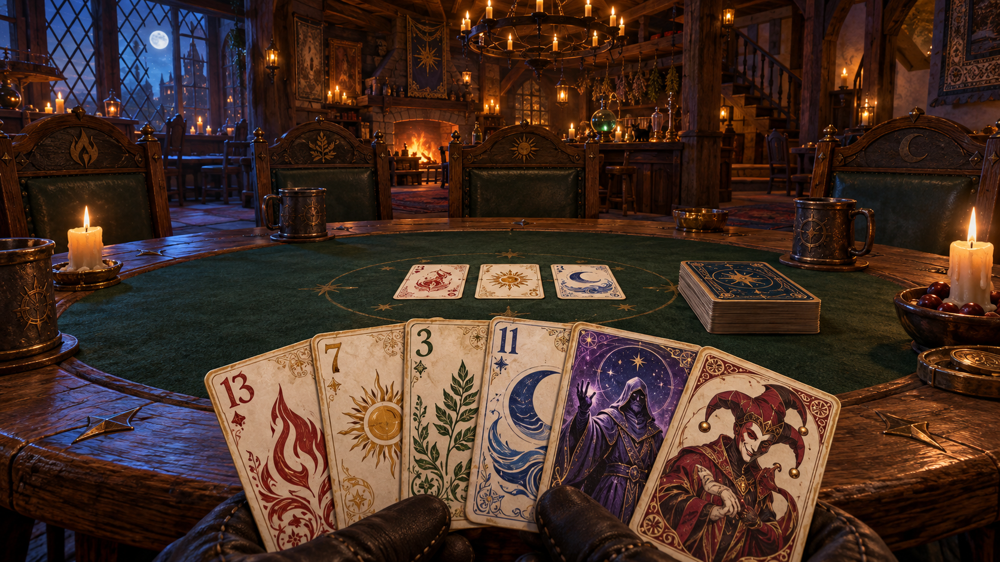

# Asset Lab · Die dunkle magische Taverne

Das Lab ist eine eigene Roblox-Testszene. Zuerst beurteilen wir hier die Gestaltung; anschließend übernehmen wir ausgewählte Assets in das eigentliche Wizard-Spiel. Das bestehende `Wizard.rbxlx` und seine Spiellogik werden durch das Lab nicht verändert.

## Öffnen

**`AssetLab.rbxl`** aus dem Repository in Roblox Studio öffnen. Im lokalen Arbeitsordner liegt zusätzlich die gleichwertige XML-Datei **`AssetLab.rbxlx`**. Die Taverne und sechs Musterkarten sind schon im Editor sichtbar und einzeln auswählbar. Für Kamera, Kartenhand und Bedienelemente **Spielen** drücken.

**Du startest mit deinem normalen Roblox-Avatar am Eingang.** Mit W/A/S/D laufen und mit Leertaste springen. Geh zu einem der sechs Stühle und halte **E**, sobald **Platz nehmen** erscheint (auf Touch die Einblendung antippen, am Controller X). Erst dann erscheinen Kartenhand und Lab-Bedienleiste.

**Den Tisch verlassen:** oben rechts **Aufstehen**, die Taste **Q** oder die normale Sprungtaste verwenden. Du stehst anschließend hinter dem Stuhl und nutzt wieder Roblox' normale Lauf- und Kamerasteuerung. **Enter** spielt im Sitzen eine Karte aus; die Leertaste bleibt zum Springen beziehungsweise Aufstehen frei. Auch nach einem Respawn beginnt die normale Steuerung wieder.

Im Editor liegt die Geometrie unter **Workspace → TavernStudy**. Die sechs Musterkarten befinden sich darin unter **EditorCardGallery**. Beim Teststart verschwindet diese Galerie und wird durch die lokal bedienbaren Karten ersetzt. Die feste Lab-Kamera ist nur während des Sitzens aktiv. Änderungen an den eingebauten Modellen werden beim nächsten Neubau aus den Quellen überschrieben; dauerhafte Anpassungen deshalb in `src/assets/` vornehmen.

## Was wir im Lab prüfen

| Bereich | Vorhandene Studie | Entscheidung vor Integration |
| --- | --- | --- |
| Raum | Dunkle Taverne, Holzbalken, Mondfenster, Kamin, Alchemie-Regal | Stimmung, Hintergrundtiefe, Helligkeit |
| Tisch | Räumlicher Eichenholztisch, Einlegearbeiten, dunkler Filz, sechs Stühle | Größe, Höhe, Blickwinkel und freie Spielfläche |
| Karten | Körper mit Papierkante, zwei echte Oberflächen, vier Farben, Wizard und Narr | Format, Lesbarkeit, Rückseite, Farbunterscheidung |
| Kamera | Sitzplatz, Draufsicht und Kartenprüfung | Wie nah/hoch der Spieler sitzt und wie viel Tisch sichtbar bleibt |
| Bewegung | Roblox-Avatar, normale Lauf-/Sprungsteuerung, sechs native Seats und Platznehmen per ProximityPrompt | Hineingehen, Hinsetzen, Aufstehen, Respawn und Kamerarückgabe |
| Interaktion | Kartenfächer, Anheben, Umdrehen, Ausspielen | Überlappung, Tempo, Klarheit der Auswahl |
| Licht | Taverne, neutral und Mondlicht | Stimmung bei gleichzeitig gut lesbaren Karten |
| Figuren | Einfache sitzende Maßstabs-Dummys | Platzbedarf; **noch kein Charakterdesign** |

Die Karten sind echte Parts mit Vorder- und Rückseite als SurfaceGui. Sie werfen Schatten und werden von anderen Objekten verdeckt. Die Bedienleiste dient nur dem Lab. Spielregeln, Mehrspieler-Kartensynchronisierung und verdeckte Hände sind hier nicht angeschlossen.

## Bedienung

- **1 / Am Tisch:** Sitzperspektive. Mit gedrückter rechter Maustaste umsehen.
- **2 / Überblick:** Tisch und Kartenablagen von oben.
- **3 / Karte prüfen:** Einzelkarte groß ansehen; mit rechter Maustaste ziehen, um sie zu drehen.
- **← / →:** Andere Musterkarte auswählen.
- **F / Umdrehen:** Rückseite der ausgewählten Karte zeigen.
- **Enter / Auf Tisch:** Ausgewählte Handkarte auf die Spielfläche bewegen.
- **Q / Aufstehen / Sprungtaste:** Den Sitzplatz verlassen und wieder frei herumlaufen.
- Eine Karte anklicken: auswählen; ausgewählte Karte erneut anklicken: ausspielen.
- **R / Neu austeilen:** Hand und Ablage zurücksetzen.
- **Hand:** 6, 10 oder 20 Karten vergleichen.
- **Zahlenkarte:** Die Werte 1, 7 oder 13 auf allen vier Farbmustern prüfen.
- **Lesbarkeit:** Unterstützte Kartenbeleuchtung mit stärkerem Einfluss des Raumlichts vergleichen.

Die freie Bewegung und das Springen nutzen Roblox' Standardsteuerung, einschließlich ihrer Touch-/Controller-Unterstützung. Die Kartenprüfung ist für Maus und Tastatur ausgelegt. Schaltflächen und Kartenauswahl sind auch per Touch erreichbar; Gestensteuerung für das sitzende Umsehen und vollständige Controller-Bedienung der Karten sind noch nicht umgesetzt. Die Sitzplätze werden auf dem Server belegt; die Kartenstudien sind weiterhin pro Client lokal und noch keine gemeinsame Mehrspielerpartie.

## Bildsprache und einzelne Illustrationen



**Dieses Bild ist ein mit Imagegen erstellter Gestaltungsentwurf, kein Screenshot aus Roblox Studio.** Es zeigt die angestrebte Bildsprache für Holz, Licht, Papier und spätere Illustrationen. Das Lab enthält zunächst einfachere, native 3D-Geometrie und bearbeitbare Ornamentstudien. Die gemalten Figuren, verzierten Stuhllehnen und Texturdetails des Zielbilds sind noch keine fertigen Spielassets.

Wir verwenden die Sitzperspektive und das räumliche Tischgefühl von Liar's Bar als Referenz, entwickeln aber eigene Karten, Figuren und Raumgestaltung.

Für eine einzelne Kartenillustration:

1. Das Motiv unabhängig von Zahl, Rahmen und Kartenrückseite erstellen; die Zahlen bleiben im Spiel separat und scharf.
2. Bild in Roblox über den Asset Manager importieren und die Bild-ID ermitteln. Das Bild muss für die Experience zugänglich sein; Roblox kann es zunächst moderieren.
3. Im Lab **Karte prüfen** wählen, die passende Karte auswählen und **Illustration testen** öffnen.
4. Die Bild-ID eintragen und **Vorderseite** klicken. **Rückseite** wendet ein Bild auf alle Kartenrücken an. Ein leeres Feld stellt den Ornamententwurf wieder her.
5. Vorderseite, Rückseite, Fächer mit 20 Karten, Entfernung und alle drei Lichtstimmungen prüfen.
6. Eine gewählte Bild-ID in `ArtDirection.images` speichern. Eingaben im Lab selbst gelten nur für die laufende Sitzung.

**Nächste tatsächliche Art-Assets:** eine Wizard-Illustration als Stilprobe, eine Narr-Illustration, vier Farbsymbole und eine symmetrische Kartenrückseite. Erst nach deren Beurteilung folgen die restlichen Kartenmotive und feinere Tisch-/Raummodelle. Das Zielbild wird nicht als Kartentextur verwendet.

## Prüfrunde in Studio

1. **Sitzhöhe:** Fühlt es sich an, als säßest du wirklich am Tisch? Verdeckst du mit der Kartenhand zu viel Spielfläche?
2. **Lesbarkeit:** Sind Zahl, Farbe und Sonderkarte auf Anhieb erkennbar – auch mit 20 Karten und dunklem Licht?
3. **Kartenkörper:** Ist die Vorderseite richtig herum? Bleibt die Rückseite eigenständig? Liegt die ausgespielte Karte sichtbar über dem Filz?
4. **Bewegung:** Ist die hervorgehobene Karte eindeutig? Wirkt das Ausspielen zu schnell, zu langsam oder zu schwebend?
5. **Gestaltung:** Passen Filz, Holz, Metall und Beleuchtung zusammen? Was fehlt gegenüber dem Zielbild?
6. **Leistung:** Mit Studios Performance-Anzeige bei 6 und 20 Handkarten vergleichen. Die geometrischen Tests sind kein Ersatz für die Messung auf deinem Mac.
7. **Roblox-Steuerung:** Vom Eingang zum Stuhl laufen, E zum Sitzen, mit Q/Button und separat mit der Sprungtaste aufstehen. An einem anderen Stuhl erneut sitzen, danach über das Roblox-Menü den Avatar zurücksetzen. Bewegung und Kamera müssen jedes Mal zurückkehren. Mit zwei Test-Clients prüfen, dass ein belegter Stuhl nicht doppelt belegt wird.

Rückmeldungen je Asset mit **behalten / überarbeiten / verwerfen** festhalten. Wir übernehmen erst die im Lab ausgewählten Varianten in die eigentliche Spielansicht.

## Quellen, Aufbau und technische Prüfung

| Datei | Zweck |
| --- | --- |
| `src/assets/ArtDirection.lua` | Palette, Kartengröße, Muster, Bild-IDs |
| `src/assets/CardModel.lua` | Wiederverwendbare 3D-Karte und beide Oberflächen |
| `src/assets/Tavern.lua` | Raum, Möbel, Beleuchtung und Maßstab |
| `src/assets/TableLayout.lua` | Physische Kamera-, Hand- und Kartenpositionen |
| `lab/client/Main.client.lua` | Lokale Prüfansichten, Interaktion, Bildvorschau |
| `lab/server/Seating.lua` | Native Sitzplätze, Distanz-/Belegungsprüfung und Aufstehen |
| `lab/models/CardSamples.rbxm` | Sechs separat in Studio importierbare Kartenmodelle |
| `lab/models/TavernStudy.rbxm` | Im Editor sichtbare Taverne einschließlich Musterkarten |
| `tools/build_lab.luau` | Modellbau mit Lune; Eigenschafts-, Geometrie- und Exportprüfungen |

Neubau mit **Lune 0.11.1**, **Rojo 7.7.1** und **Luau 0.743**:

```sh
lune run tools/build_lab.luau
rojo build lab.project.json -o AssetLab.rbxl
rojo build lab.project.json -o AssetLab.rbxlx
python3 tools/check.py --lab
```

Der Modellbau prüft reale Roblox-Eigenschaften und Datentypen, sechs Karten mit zwölf Oberflächen, Kartenrichtung, positive Körpermaße, Verankerung, Abstand zum Tisch, die Fächerprojektion für 6/10/20 Karten bei mehreren Desktop-Seitenverhältnissen sowie Modell-Export und Wiedereinlesen. Außerdem werden der begehbare Boden, der Spawn, sechs nutzbare Seats, deren zur Kamera passende Position und freie Ausstiegspositionen geprüft. Das Lab enthält 297 verankerte Bauteile. Acht zusätzliche Sitzplatztests führen den tatsächlichen Servercode mit simulierten Avataren aus und prüfen Distanz, Belegung, Aufstehen und den Sprungausstieg. **Darstellung, tatsächliche Avatarphysik, Kameraübergänge, Eingaben und Bildladen müssen zusätzlich in Roblox Studio beurteilt werden.** Lune rendert keine Roblox-Szene.

Technische Referenz: [Roblox SurfaceGui](https://create.roblox.com/docs/reference/engine/classes/SurfaceGui). Räumliche Referenz: [Liar's Bar](https://store.steampowered.com/app/3097560/Liars_Bar/).
